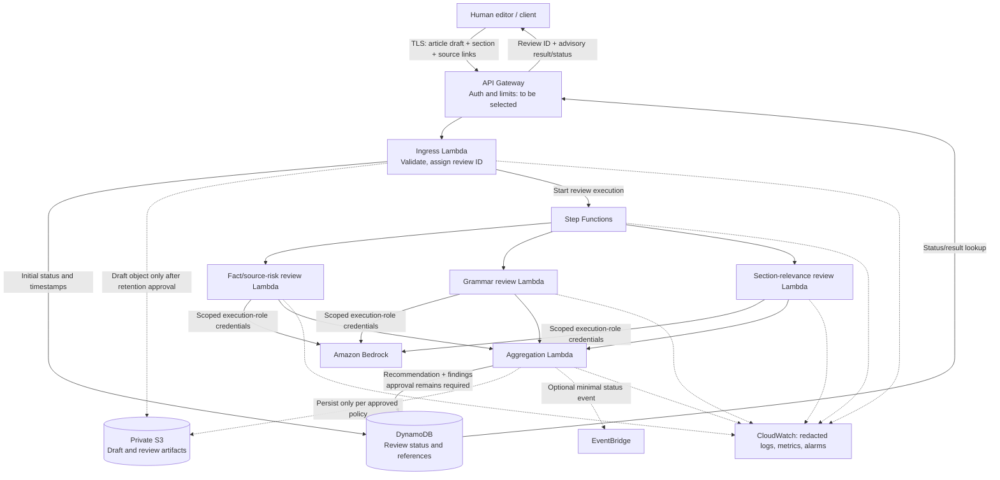

# Magazine Editor — AWS Architecture

**Status:** Proposed future hosting architecture. This document describes a target design; it is not an implementation record, deployment plan approval, or authorization to provision AWS resources.

## Purpose and scope

Host the Magazine Editor editorial-review workflow as a serverless AWS service. Editors submit an article for advisory review, receive findings, and make the final decision themselves. The service must not approve or publish articles automatically.

The current repository is a local Python package/CLI. It has deterministic review logic and a Strands/Amazon Bedrock model-backed workflow, but it does not yet include API Gateway handlers, Lambda entrypoints, a Step Functions state machine, cloud persistence code, or a deployable artifact. Those are future implementation work.

## Target components

| Component | Proposed responsibility | Status / constraint |
| --- | --- | --- |
| Editor client | Submit a draft and retrieve a review result. A web UI is not part of the current application. | Client type and identity provider are undecided. |
| Amazon API Gateway | HTTPS ingress, request limits, throttling, and versioned review API. | API routes, authentication/authorization, payload limits, and error contract must be designed. |
| Ingress Lambda | Validate the request, assign a correlation/review ID, record initial status, and start an execution. | No handler or request schema exists yet. |
| AWS Step Functions | Orchestrate the review stages, failure handling, and aggregation. | State-machine type, sequencing/parallelism, task contracts, retries, timeouts, and idempotency are undecided. |
| Review Lambdas | Adapt the existing fact/source-risk, grammar, and section-relevance assessments to cloud execution. | The local workflow currently invokes three Strands agents sequentially in one process. Separate handlers are a proposed cloud boundary, not existing code. |
| Amazon Bedrock | Produce the three model assessments. | Model, source Region, inference profile, access, quotas, residency, and pricing must be selected and verified. |
| Amazon S3 | Private storage for article and review artifacts when retention and access rules are approved. | The deployment foundation proposes Block Public Access, bucket-owner-enforced ownership, and SSE-S3. Object naming, lifecycle, versioning, and retention are undecided. |
| Amazon DynamoDB | Track review ID, status, timestamps, and result/artifact references. | The foundation has placeholder string keys (`PK`, `SK`); the application schema and retention policy are not defined. |
| Amazon EventBridge (optional) | Emit a completion/status event for approved downstream consumers. | No consumer is defined. Events must not trigger publication. Defer until there is a concrete need. |
| Amazon CloudWatch | Collect operational metrics, alarms, and redacted application/workflow logs. | Log fields, retention, alarms, and any model logging must be specified. Never log credentials or full article text by default. |

## Data flow

The following flow is a proposed logical design. Exact APIs and state payloads are not yet implemented. The diagram does not authorize deployment.

### Flow details

1. An editor submits a JSON article draft to a versioned HTTPS API. The request contract should set size limits and validate title, body, section, source references, and any optional metadata. Authentication and authorization are a release gate, not an assumed feature.
2. API Gateway forwards an authorized request to the ingress Lambda. The Lambda validates input, creates a review ID/correlation ID, records an initial non-final status such as `pending_review`, and starts a Step Functions execution. An asynchronous response (for example, review ID plus status) is a candidate design; synchronous versus asynchronous behavior requires latency and workload requirements.
3. The workflow invokes the fact/source-risk, grammar, and section-relevance stages. Each stage receives only the data it needs, calls the selected Bedrock model, and returns a validated score/findings structure. The current local implementation runs these stages sequentially; whether the cloud workflow preserves that order or runs independent stages in parallel must be decided with the state-machine contract.
4. For large payloads, the workflow should pass an S3 object reference rather than duplicate article text through state and logs. S3 storage is conditional on an approved retention/deletion policy. Do not put drafts into Step Functions execution history or CloudWatch logs without an explicit data-handling review.
5. The aggregation stage combines the assessments into an advisory recommendation. It sets an explicit human-review-required state and cannot publish or approve content.
6. The service records status and the final result or a result reference. The client retrieves the result using the review ID. An EventBridge completion notification may be added later; it should contain minimal metadata and have no publishing side effect.

## Security and data handling

- **Cloud credentials:** Lambda uses its execution role and temporary AWS credentials. Do not package the local `AWS_BEARER_TOKEN_BEDROCK`, `.env`, or any long-lived credential. The current local adapter accepts a bearer token; cloud authentication is a required code change and must be verified before hosting.
- **Bedrock permissions:** Grant only the reviewed invocation action and selected model/profile resources. If an inference profile routes to multiple Regions, review each destination and scope IAM accordingly. Do not use wildcard model resources as a shortcut.
- **Article confidentiality:** Drafts may be unpublished or sensitive. Decide allowed data classes, model/Region routing, residency, retention, deletion, backup, access boundaries, and audit behavior before using real drafts.
- **Storage:** Keep S3 Block Public Access enabled and bucket ownership enforced. The foundation proposes SSE-S3. Decide whether policy requires a customer-managed KMS key, S3 versioning, lifecycle expiration, DynamoDB point-in-time recovery, and a deletion process.
- **Logging:** Log request IDs, stage names, durations, safe error categories, and status transitions. Do not log bearer tokens, AWS credentials, full article text, source contents, or raw model prompts/responses by default. Set and test retention policies.
- **API protection:** Select an identity/authorizer design, authorization policy by publication/team, throttling, request-size limits, and abuse controls before exposing an endpoint.
- **Human approval:** Model recommendations are advisory. A high score or `recommend_approval` must never be treated as publication authorization. No CMS integration is included.

## Failure and operations model to define

Before implementation, define per-stage timeouts, retry limits/backoff, failure/catch paths, duplicate request/idempotency behavior, partial-result behavior, terminal statuses, API response mapping, and safe user-visible errors. Add CloudWatch metrics/alarms for API failures, workflow failures/timeouts, Lambda errors/throttles, and Bedrock invocation errors/latency. Bedrock throttling, model access failures, malformed model output, and downstream storage failures must not produce an approval state.

## Current implementation versus target

| Capability | Current local code | AWS target |
| --- | --- | --- |
| Request entry | CLI reads a local article JSON file. | Versioned API Gateway request and ingress Lambda. |
| Workflow | Python workflow invokes three Strands agents. | Step Functions orchestration with defined task contracts and error handling. |
| Model auth | Local configuration can load a bearer token from environment/dotenv. | Lambda execution-role credentials; no bearer token in deployment. |
| Persistence | Offline runner writes a local JSON result file; CLI prints result JSON. | Approved S3 artifact policy and DynamoDB review lifecycle/schema. |
| Deployment artifact | No Lambda handler or cloud artifact. | Versioned, pinned, scanned Lambda package/container and infrastructure definition. |
| User decision | Output is advisory and requires a human editor. | Preserve explicit human approval; no automatic publication. |

## Implementation gates

1. Complete local readiness and known scoring regressions before cloud work; add tests for the offline grammar heuristic weakness documented in the deployment plan.
2. Select the AWS account/Region, model or inference profile, data-residency behavior, identity provider, request/response contract, expected traffic, and cost envelope.
3. Define S3/DynamoDB schemas, retention/deletion, backup, logging/redaction, and IAM policies.
4. Implement and test Lambda adapters, workflow states, request/status/result contracts, role-based Bedrock auth, idempotency, and failure handling.
5. Build a reproducible Lambda-compatible artifact, lock dependencies, scan dependencies, and record artifact digests. The CLI package alone is not deployable as a Lambda service.
6. Validate in an isolated environment only after explicit approval. A Bedrock call can incur charges. Deployment/provisioning requires separate explicit authorization; this document does not grant it.

## Decisions still open

- AWS account, deployment Region, environment separation, and organization policies.
- Authentication/authorization and editor identity mapping.
- Direct in-Region model versus inference profile, model access, quotas, and pricing.
- API schema, size limits, sync/async behavior, status contract, and idempotency keys.
- Step Functions type, stage order/parallelism, retries, timeouts, and result paths.
- Whether and how article text/results persist in S3, DynamoDB schema, retention/deletion, and backups.
- CloudWatch log/metric retention, alarms, and data redaction.
- VPC/private connectivity requirements, KMS key requirements, and deployment artifact/runtime.
- Whether EventBridge notifications are necessary and which non-publishing consumers are authorized.
- Cost estimate based on approved traffic, article/token sizes, model, retention, logs, and chosen AWS services.

## Authorization boundary

The source deployment plan records `production_deployment_allowed: false`, `authorization_state: not_authorized`, and states that AWS deployment/provisioning is not authorized. This architecture document is design-only. Do not run CloudFormation, create resources, query account credentials, or perform cloud-side tests based on this document. Any future deployment needs a separate explicit approval naming the account, Region, resources, IAM changes, cost/retention implications, and permitted action.
